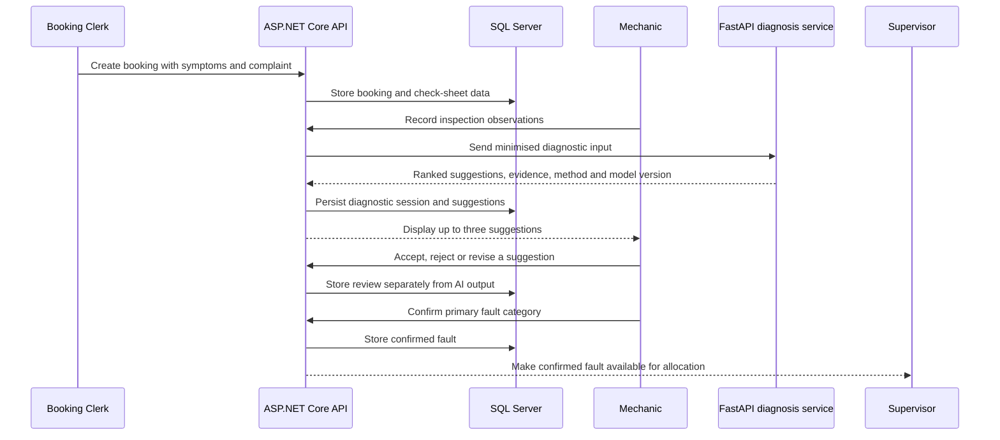
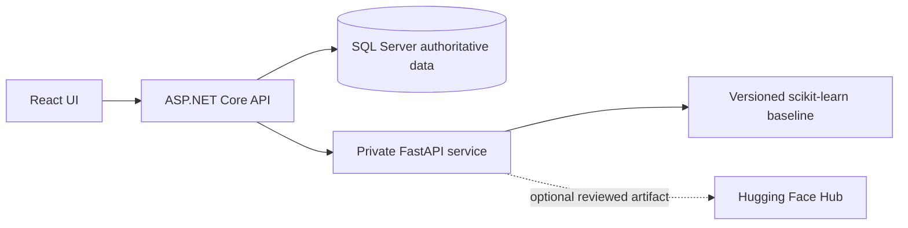

# AI-assisted fault diagnosis: where it fits

## Purpose

The diagnostic feature supports the mechanic during inspection. It does not replace the mechanic, approve a repair automatically, or change a booking's confirmed fault without an explicit human action.

## Position in the workflow

## What is sent to the service

Only diagnostic features are sent: selected symptom identifiers, structured inspection observations, a limited complaint description, and supported vehicle attributes such as make/model where the model has been trained to use them. Customer names, contact details, registration numbers and complete booking records are not sent to a public AI provider.

The ASP.NET API is the only intended caller of the Python service. The browser should never call FastAPI directly. A request timeout and input validation protect the API from a slow or malformed diagnostic request. If the Python service is offline, the API returns a clear unavailable-service response and the mechanic can continue with manual inspection.

## Diagnostic output

Each suggestion contains a fault-category identifier, rank, suggested inspection or repair action, method, model version, score type and supporting evidence where available. A score is not presented as a calibrated probability unless calibration has actually been performed and documented. The service may return fewer than three suggestions or `insufficient_evidence`.

The current project includes a small fictional demonstration baseline. It is reproducible and CPU-friendly, but it is not Amcotts research data and its output must not be described as validated workshop accuracy. A real deployment requires labelled historical incidents, a documented data-quality process, a vehicle/incident-aware evaluation split, review for leakage, and a separate validation set.

## Human confirmation boundary

AI suggestions are immutable historical evidence once stored. The mechanic's response is stored separately as `Accepted`, `Rejected` or `Revised`, with the actor and timestamp. The confirmed primary fault is a separate booking/repair value. This prevents a suggestion from silently becoming a mechanical fact and ensures reports count confirmed faults only.

## Allocation and reporting

Allocation uses the confirmed or supervisor-approved fault category, not an unreviewed AI rank. The allocation service then checks mechanic skill, availability, capacity and concurrent active assignments. Reports count confirmed primary faults and completed records; they do not count every suggestion.

## Planned production boundary

Hugging Face is optional and must never be required for local operation. Remote executable model code, private tokens and credentials do not belong in the frontend. Any external dataset or model must have its source, version, license and limitations recorded before use.

## Operational measures

The target is a diagnostic response within five seconds under a stated local workload. The application should record request duration, timeout/unavailable outcomes and model version so the target can be measured honestly. The target is not claimed as achieved until the local service and API have been tested together.
