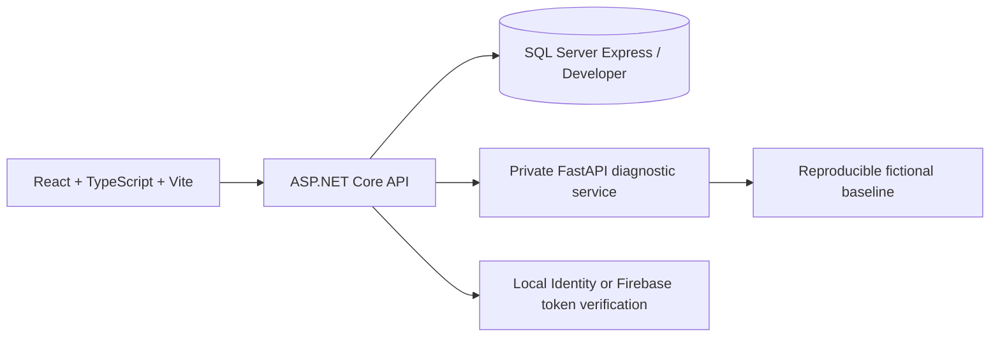
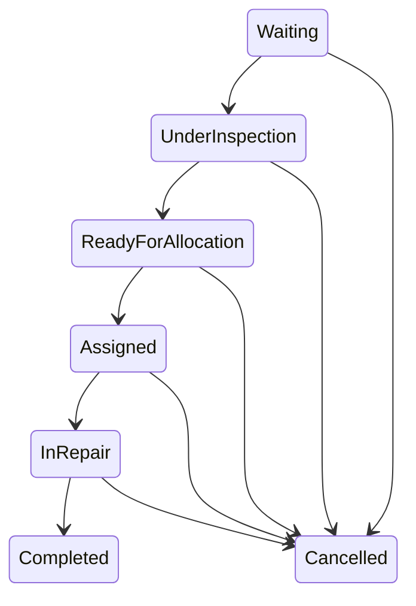

# Architecture and workflow

The UI local adapter exists for an offline demonstration. In a deployment, the API is authoritative for transitions, ownership, idempotency, allocation transactions, audit events and SQL persistence.
